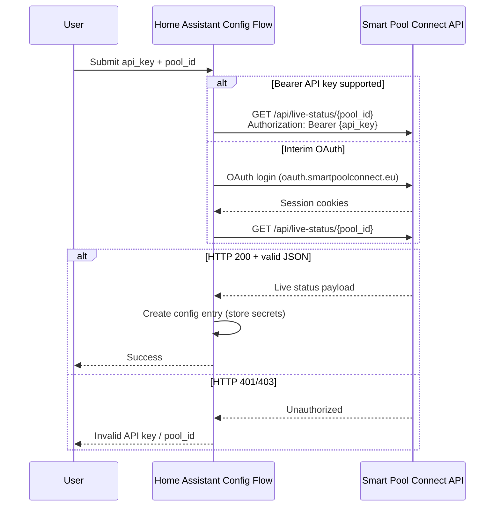
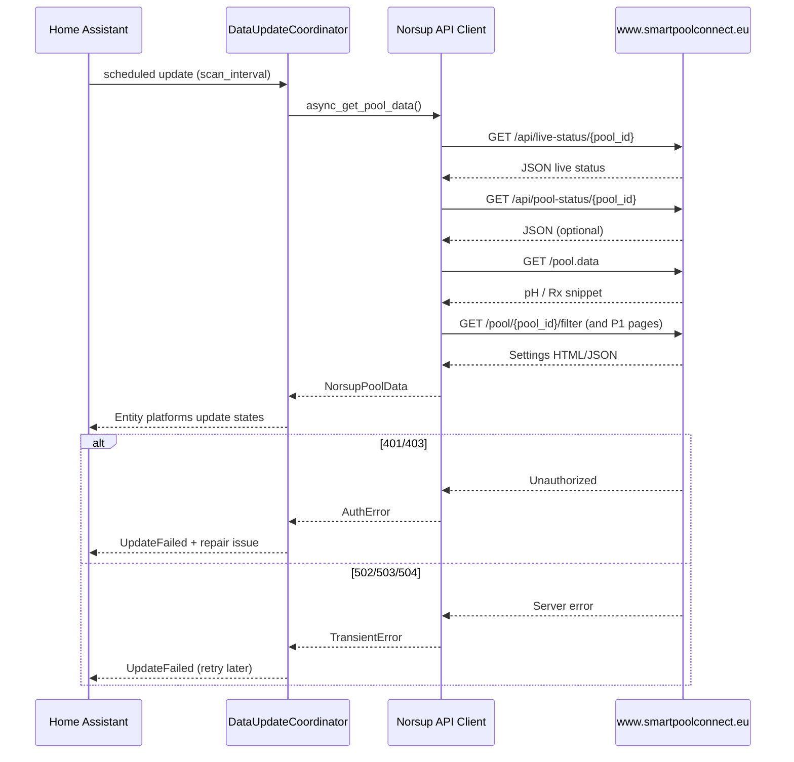

# Norsup Smartpool × Home Assistant — Architecture

Design document for the **Norsup Smartpool** custom Home Assistant integration (`custom_components/norsup_smartpool`). This integration targets the **Smart Pool Connect** cloud platform used by **NorsupOne V3** and related Norsup pool automation (successor to legacy “Smart Pool Control” / NorsupOne IoT portal).

**Status:** Architecture only (no production code in this document).  
**Last reviewed:** 2026-10-16  
**Sources:** Norsup Smart Pool Connect owner manual (MAC claim, OAuth portal), NorsupOne installer documentation (on-device API key for provisioning), and public reverse-engineering of the owner portal HTTP surface (community reference: [smartpoolconnect-owner](https://github.com/DieterC1984/smartpoolconnect-owner)).

---

## 1. Scope and goals

| In scope | Out of scope |
|----------|----------------|
| Cloud polling (and selective writes) via Smart Pool Connect | Local **Modbus** on NorsupOne V3 (separate HA Modbus / heat-pump integrations) |
| One HA config entry per pool (pool UUID) | Installer/builder portal workflows |
| Sensors and controls exposed by the owner portal API | Chemical store, warranty, billing |
| API-key–based setup UX per product brief | Scraping undocumented mobile app binaries |

**IoT class:** `cloud_polling` (default). Push/WebSocket is not documented on the public portal; revisit if Norsup publishes one.

---

## 2. Platform overview

### 2.1 Smart Pool Connect (current Norsup cloud)

- **Owner portal:** `https://www.smartpoolconnect.eu`
- **OAuth / login:** `https://oauth.smartpoolconnect.eu`
- **Legacy redirect:** Pre–May 2025 “Smart Pool Control” accounts reuse credentials on the new OAuth host (per Norsup manual).
- **Pool claim:** Pool owners claim a controller using the **MAC address** shown on the NorsupOne screen (one-time portal setup, not a runtime API parameter).
- **Pool identity at runtime:** **Pool UUID** (`pool_id`) embedded in portal URLs, e.g. `/pool/{pool_id}/filter`.

### 2.2 Legacy NorsupOne “Smartpool” app (installer provisioning)

- Older flows reference `http://smartpool.nuventuretech.com/` and installer pairing with **serial number + API key printed on the control box** (provisioning only).
- That on-device key is **not** the same as a documented REST bearer token on Smart Pool Connect. The integration should not ask end users for the physical box key unless a supported cloud endpoint explicitly requires it.

### 2.3 Product brief vs observed auth

The product requires users to configure an **API key**. Norsup does **not** publish official third-party API documentation in public manuals. Observed owner-portal access today uses **OAuth login (email/password) and HTTP session cookies**, not a static `Authorization` header.

**Design decision (for implementers):**

1. **Config entry stores `api_key` (required)** and **`pool_id` (required)** as defined in §4.
2. **Validation:** `GET https://www.smartpoolconnect.eu/api/live-status/{pool_id}` with:
   - **Preferred (when Norsup provides portal API keys):**  
     `Authorization: Bearer {api_key}`  
     or  
     `X-Api-Key: {api_key}`  
     (confirm exact header name against Norsup portal docs when available).
   - **Interim (if bearer validation is not yet offered):** perform a one-time OAuth owner login using credentials supplied in the config flow (email/password) solely to obtain session cookies, then call the same live-status URL. Do **not** persist passwords in logs; store only the API key / session material in the HA config entry. Document in INSTALL.md that the UI field is labeled “API key” and link to Norsup instructions for obtaining it; note interim OAuth if keys are unavailable.
3. When Norsup ships documented API keys, drop the interim OAuth path and use bearer auth only.

---

## 3. Authentication and HTTP transport

### 3.1 OAuth session bootstrap (observed interim path)

Observed flow (Remix-based OAuth host):

1. `GET https://www.smartpoolconnect.eu/` → redirects to `https://oauth.smartpoolconnect.eu/oauth/login?...`
2. `POST .../oauth/login.data` — `application/x-www-form-urlencoded`: `email`, `password`, `device` (random device id).
3. Follow `Location` / `X-Remix-Redirect` through `.../oauth/auth.data` until callback `https://www.smartpoolconnect.eu/auth?code=...`
4. Subsequent API calls use **session cookies** for `www.smartpoolconnect.eu` (no API key in header on this path).

OAuth constants observed in community client (may change without notice):

| Constant | Example value |
|----------|----------------|
| `client_id` | `019d97d6-2f32-7deb-958b-1f76233b38ea` |
| `redirect_uri` | `https://www.smartpoolconnect.eu/auth` |
| `scope` | `email profile` |

### 3.2 API key placement (target)

| Mechanism | Where | When |
|-----------|--------|------|
| Bearer token | Header: `Authorization: Bearer {api_key}` | Preferred once documented by Norsup |
| API key header | Header: `X-Api-Key: {api_key}` | Alternative if portal specifies it |
| Session cookie | Cookie jar after OAuth | Interim only |

**Never** send the API key in URL query strings. **Never** log request headers or full responses at info level.

### 3.3 Session lifecycle

- On **401/403**: mark coordinator auth failed; config flow / options flow must re-validate.
- On **502/503/504**: treat as transient (`UpdateFailed`), retry with backoff; do not clear credentials.
- Optional: persist serialized cookie jar in config entry `data` only if required for interim OAuth (encrypted by HA); prefer long-lived API key when available.

---

## 4. Configuration entries (Home Assistant)

| Key | Required | Storage | Description |
|-----|----------|---------|-------------|
| `api_key` | Yes | Config entry `data` (HA secrets) | Portal-issued API key or bearer token (see §2.3) |
| `pool_id` | Yes | Config entry `data` | Pool UUID from Smart Pool Connect URL after claim |
| `base_url` | No | `data` | Default `https://www.smartpoolconnect.eu` |
| `oauth_base_url` | No | `data` | Default `https://oauth.smartpoolconnect.eu` (interim OAuth only) |
| `scan_interval` | No | `options` | Seconds between coordinator refreshes (default **30**, min **15**) |

**Discovery:** No mDNS discovery. User copies `pool_id` from the portal (Pools → select pool → UUID in browser path).

**Multi-pool:** One config entry per `pool_id`. Multiple entries may share the same `api_key` if Norsup keys are account-scoped.

---

## 5. API endpoints to poll and call

All paths are relative to `base_url` unless noted. Authenticated requests use bearer **or** session cookies per §3.

### 5.1 Read paths (coordinator — every scan interval)

| Priority | Method | Path | Purpose |
|----------|--------|------|---------|
| P0 | GET | `/api/live-status/{pool_id}` | Live pump, heating, cover, lighting bits, water temperature |
| P0 | GET | `/api/pool-status/{pool_id}` | Supplemental status JSON (fallback fields) |
| P0 | GET | `/pool.data` | Embedded CSV/JSON fragment for **current pH and Rx** per pool |
| P1 | GET | `/pool/{pool_id}/ph/` | pH targets, dosing/pause times (HTML form scrape or `.data` if JSON) |
| P1 | GET | `/pool/{pool_id}/cl/` | Rx/ORP targets and dosing settings |
| P1 | GET | `/pool/{pool_id}/filter` | Filter always-on, pump speed, schedules |
| P2 | GET | `/pool/{pool_id}/lighting` | Lighting schedules and always-on |
| P2 | GET | `/pool/{pool_id}/filter/backwash` | Backwash schedule |
| P2 | GET | `/pool/{pool_id}/cover` or `.../cover.data` | Cover protection and pump assists |

**Lightweight auth check (config flow):** `GET /api/live-status/{pool_id}` only; success = HTTP 200 and parseable JSON.

**Connectivity / online:** Derive `binary_sensor` from live-status reachability and sensible payload (if request fails with auth errors → offline + `problem` diagnostic).

### 5.2 Write paths (platform actions — on user command)

| Action | Method | Path | Notes |
|--------|--------|------|-------|
| Set filter / pump speed | PUT | `/pool/{pool_id}/filter.data` | `pump_speed`, `always_active`, schedules |
| pH target & dosing | PATCH | `/pool/{pool_id}/ph.data` | Form-encoded fields |
| Rx target & dosing | PUT | `/pool/{pool_id}/cl.data` | `rx.target`, etc. |
| Lighting | PUT | `/pool/{pool_id}/lighting.data` | |
| Cover open/close/stop | POST | `/api/cmd/{pool_id}/cover_open` etc. | JSON body |
| Start backwash | POST | `/pool/{pool_id}/cmd.data` | `exec=backwash` |

Expose HA controls **only** when the corresponding GET settings page succeeds; do not fabricate writable entities.

### 5.3 Rate limits and polling

- **No published rate limits** from Norsup. Use conservative polling:
  - Default coordinator interval: **30 s**
  - Minimum recommended: **15 s**
  - Jitter ±10% to avoid aligned bursts
- On repeated 429 (if observed): double interval up to **300 s** and log one warning.
- Batch reads in one coordinator tick; avoid N+1 writes.

---

## 6. Entity mapping

Normalized coordinator model → Home Assistant platforms.

| Portal / API field | HA entity (suggested) | Platform | Device class / unit | Update source | Interval |
|--------------------|----------------------|----------|---------------------|---------------|----------|
| `ph` (from `/pool.data`) | `sensor.{pool}_ph` | `sensor` | — / pH | Coordinator | 30 s |
| `rx` / ORP (from `/pool.data`) | `sensor.{pool}_orp` | `sensor` | — / mV | Coordinator | 30 s |
| `water_temperature` / `water_temp` (live-status) | `sensor.{pool}_water_temperature` | `sensor` | `temperature` / °C | Coordinator | 30 s |
| `pump_status` (live-status) | `binary_sensor.{pool}_pump_running` | `binary_sensor` | `running` | Coordinator | 30 s |
| `pump_speed` (live-status or filter) | `sensor.{pool}_pump_speed` | `sensor` | — (enum: off/low/medium/high/maximum) | Coordinator | 30 s |
| `filter_always_active` | `switch.{pool}_filter_always_on` | `switch` | — | Coordinator + PUT filter | 30 s |
| `filter_pump_speed` (writable) | `select.{pool}_filter_pump_speed` | `select` | options from portal | Coordinator + PUT | 30 s |
| Live-status reachability | `binary_sensor.{pool}_cloud_online` | `binary_sensor` | `connectivity` | Coordinator | 30 s |
| `ph_target` | `number.{pool}_ph_target` | `number` | pH | Coordinator + PATCH ph | 30 s |
| `rx_target` | `number.{pool}_orp_target` | `number` | mV | Coordinator + PUT cl | 30 s |
| `water_temperature_target` | `number.{pool}_water_temperature_target` | `number` | °C | If API exposes write | 30 s |
| `lighting_on` / always_active | `light.{pool}_pool_light` or `switch` | `light` or `switch` | — | Coordinator + PUT lighting | 30 s |
| `heating_on` | `switch.{pool}_heating` | `switch` | — | Only if write endpoint exists | 30 s |
| Cover commands | `cover.{pool}_slatted_cover` | `cover` | — | POST cmd endpoints | On demand |
| Start backwash | `button.{pool}_start_backwash` | `button` | — | POST cmd.data | On demand |
| `outside_temperature`, `solar_temperature` | Optional sensors | `sensor` | `temperature` / °C | Coordinator | 30 s |

**unique_id pattern:** `{pool_id}_{field}` (stable across restarts).

**Device:** Single `device_info` per pool — name from portal profile, manufacturer `Norsup`, model `Smart Pool Connect`, identifiers `{(DOMAIN, pool_id)}`.

### 6.1 Unsupported or read-gap fields

| Area | Behavior |
|------|----------|
| pH/Rx instantaneous | May only appear in `/pool.data` text bundle, not in JSON live-status — parser must tolerate missing JSON fields |
| Rx spikes | Community clients filter invalid Rx jumps; optional sanity filter (e.g. ignore delta > 300 mV) |
| Eco valve, geofencing, chemical store | Omit entities unless stable GET endpoints exist |
| Write-only portal fields | Do not show HA controls; optional `sensor` with `unknown` if read fails |
| Cover state | Map portal enum to HA `open`/`closed`/`opening`/`closing`; use `unknown` when ambiguous |

---

## 7. Home Assistant structure

```
custom_components/norsup_smartpool/
  __init__.py          # Setup config entry, create coordinator
  manifest.json
  config_flow.py       # API key + pool_id; validate live-status
  const.py
  api/                 # aiohttp client (auth, parse, write helpers)
  coordinator.py       # DataUpdateCoordinator
  sensor.py
  binary_sensor.py
  switch.py
  select.py
  number.py
  button.py
  cover.py             # if cover commands enabled
```

**Coordinator responsibilities:**

- Single `async_update_data()` calling P0/P1 reads
- Merge into typed `NorsupPoolData` dataclass
- Raise `UpdateFailed` on persistent errors; return stale data only when HA allows and auth is still valid

---

## 8. Sequence diagrams

### 8.1 Config flow (API key validation)



### 8.2 Data update coordinator



---

## 9. Security

- **API keys, bearer tokens, OAuth passwords, and session cookies** are stored **only** in Home Assistant **config entry** data (and `config_entry` options), which HA treats as sensitive. They must **never** appear in:
  - Git commits, CI logs, or example YAML in this repository
  - Info/debug logs (redact `Authorization`, cookies, and `api_key` fields)
  - GitHub issues or screenshots from users
- Use HA `vol.Schema` password fields for secrets in the config flow.
- Unit tests must use **fixtures** with fake tokens (`test_api_key_…`).
- Prefer **API key rotation** via options flow: validate new key before replacing stored value.
- Cloud dependency implies TLS verification enabled (default aiohttp); no insecure downgrade.

---

## 10. Risks and limitations

| Risk | Impact | Mitigation |
|------|--------|------------|
| **Undocumented cloud API** | Breaking changes without notice | Pin client to defensive parsing; integration tests with fixtures; monitor community projects |
| **No official API key program** | Product “API key” UX may require interim OAuth | Document clearly in INSTALL.md; implement bearer path when Norsup publishes keys |
| **Cloud availability** | Pool control unavailable when portal is down | `binary_sensor` connectivity; surface `unavailable` states; document local Modbus alternative for critical equipment |
| **Read vs write gaps** | Users expect controls that portal does not expose readably | Only create write entities after successful GET; see §6.1 |
| **HTML scraping** | Some settings live in Remix HTML, not pure JSON | Isolate parsers; test fixtures from saved pages; prefer `.data` endpoints when present |
| **Account ToS** | Automation may violate Norsup terms | Unofficial integration disclaimer in README; rate-limit polling |
| **Multi-user OAuth** | Session invalidation when user logs in elsewhere | Re-auth via options flow |
| **Legacy vs new portal** | Wrong host for old accounts | Configurable `base_url`; defaults to Smart Pool Connect EU |

---

## 11. References

- Norsup Smart Pool Connect manual — OAuth, MAC claim: `https://oauth.smartpoolconnect.eu/`
- NorsupOne system overview (app control of pH, filtration, heating): `https://norsup.com/norsupone-system`
- Community HTTP surface reference: `https://github.com/DieterC1984/smartpoolconnect-owner` (unofficial, not affiliated with Norsup)

---

## 12. Open items for builders

1. Confirm with a real account whether Norsup has added **portal API keys** (bearer) — if yes, remove interim OAuth from config flow.
2. Capture golden **fixture JSON** for `/api/live-status/{pool_id}` and `/pool.data` snippets in `tests/fixtures/`.
3. Align `manifest.json` `iot_class` with `cloud_polling` until push exists.
4. Implement options flow for API key rotation per task plan.
